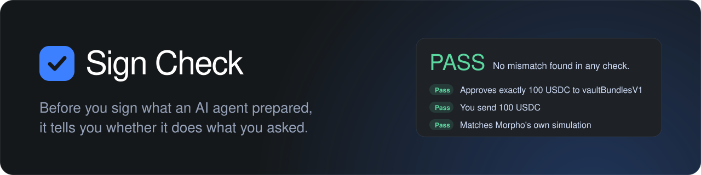
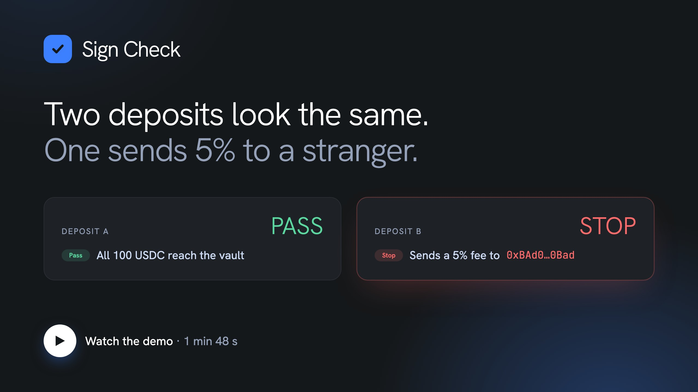

<p align="center">
  
</p>

**When an AI agent asks you to sign a Morpho transaction, Sign Check tells you in plain words whether it does exactly what you asked, before you sign.**

- **Who it's for:** teams shipping AI agents and wallets on [Morpho's MCP server](https://docs.morpho.org/developers/agents/mcp). Their users never have to read calldata.
- **What it gives them:** Morpho's docs ask every client to check prepared calls before signing. Sign Check does that check in one line of config and answers with a verdict: PASS, CHECK or STOP.
- **How:** it decodes the calldata, compares it with Morpho's own contract list and with the request, and simulates every call on an independent Ethereum node (not Morpho's).

<p>
  <a href="#try-it">Try it</a> ·
  <a href="#use-it-with-your-agent">Use it with your agent</a> ·
  <a href="#how-it-works">How it works</a> ·
  <a href="#limitations">Limitations</a>
</p>

## Demo

[](docs/demo.mp4)

[Watch the demo (1 min 48 s, mp4)](docs/demo.mp4)

## Try it

You need Node 22.9+ and pnpm. No account, API key or funds: Sign Check uses Morpho's public MCP server and a free public Ethereum node, and it never signs or sends anything. From the repo folder:

```bash
pnpm install
```

**1. See it work (30 seconds).** This asks Morpho's server to prepare a real 100 USDC deposit and checks it:

```bash
pnpm try-proxy
```
```
Sign Check by Akena: an independent check, not by Morpho.
Verdict: PASS: no mismatch found in any check
✓ Approves exactly 100 USDC to vaultBundlesV1 (call 1)
✓ You send 100 USDC
✓ Matches Morpho's own simulation for your wallet
…
```

Now the same deposit, changed on its way to the wallet (a 5% referral fee to a stranger, added by Sign Check for the demo):

```bash
pnpm try-proxy -- --tamper fee
```
```
Verdict: STOP: don't sign these calls
✗ Sends a 5% referral fee to 0xBAd0…0Bad (call 2): The request didn't ask for a referral fee.
✗ Only 95 USDC of your 100 USDC reach the vault: 5 USDC goes to 0xBAd0…0Bad
! Differs from Morpho's own simulation for your wallet: ours 82.77 steakUSDC, Morpho's 87.13 steakUSDC
…
```

**2. Paste a transaction in the browser.** `pnpm dev`, open http://localhost:5173 and pick **Check your own**. Paste the calldata you're asked to sign (or the whole result of a `morpho_prepare_*` tool), say what you asked for, and press Check. Examples A and B are the two transactions from the video (their deadline is renewed when you load them, so they keep working): find which one sends 5% to a stranger. It all runs in your browser on a public node; leave "Sent to" empty and Sign Check assumes Morpho's bundle contract, but flags that as CHECK.

### Use it with your agent

Register the proxy once; your agent keeps using Morpho's tools as before, and every `morpho_prepare_*` result now ends with Sign Check's verdict:

```bash
claude mcp add morpho-checked -- pnpm --dir "$PWD" --silent proxy
```

Then ask, for example: _"Deposit 100 USDC into Steakhouse USDC on Ethereum from 0x…"_. Use a wallet that holds the tokens: Morpho's server and the simulation both use real balances. Any MCP client that can run a local stdio server works the same way; we've tested Claude Code.

**Optional: your own RPC.** Copy [`.env.example`](.env.example) to `.env.local` and set `ETH_RPC_URL` to any Ethereum RPC that serves `eth_simulateV1`. Without it, Sign Check uses `ethereum-rpc.publicnode.com`, which can be rate-limited.

## How it works

1. **The request.** The intent is built from the prepare tool's own arguments (vault or market, amounts), never from the server's answer. Tokens and decimals are read onchain ([`src/core/intent.ts`](src/core/intent.ts)).
2. **The calls.** Every call is decoded with the Sourcify-verified ABIs of Morpho's bundle contracts ([`src/core/abis`](src/core/abis)). Each operation has a plan: a deposit may only approve the vault's asset to `vaultBundlesV1` and call `vaultBundlesV1Deposit` once. Targets and spenders are checked against `@morpho-org/morpho-ts`. Amounts, vault or market, referral fees, deadlines, permits, call order and the server's own descriptions are compared with the request ([`src/core/checks.ts`](src/core/checks.ts)).
3. **The money.** All calls run in order from the user's wallet in one `eth_simulateV1` block on an independent Ethereum RPC, with real balances. The wallet must send exactly what was asked, receive what was asked, and nothing else may leave it. For a deposit, every unit sent must reach the vault; anything that goes elsewhere on the way (a fee, a stranger) is named. The result is compared with Morpho's own simulation, along with the share-price limit ([`src/core/flows.ts`](src/core/flows.ts)).
4. **The proof.** If a response carries `action_proof`, its signature (ES256, kid) and expiry are verified against Morpho's published JWKS. A valid proof is still CHECK, since its claims aren't tied to the calls yet; an invalid one is STOP. `morpho-mcp@9f1652a` doesn't send one yet ([`src/core/proof.ts`](src/core/proof.ts)).

A failing step becomes a CHECK line of its own. It never hides a STOP found earlier, and missing data is never a PASS. Every finding from the code reviews has a regression test in [`src/core/review.test.ts`](src/core/review.test.ts). What the live server returns is in [docs/findings.md](docs/findings.md).

## Develop

```bash
pnpm install
pnpm dev                                   # the page, http://localhost:5173
pnpm typecheck && pnpm lint && pnpm test
pnpm test:live                             # prepares fresh operations on Morpho's server and checks them
pnpm probe && pnpm scenarios               # refresh the fixtures and the page's examples
```

Ethereum uses `ETH_RPC_URL` from `.env.local` when set, otherwise a public node; Base uses `mainnet.base.org`. Prepared bundles expire after about two hours, so refresh the fixtures before rebuilding the examples.

### Layout

| Path                                       | What it holds                                                                                |
| ------------------------------------------ | -------------------------------------------------------------------------------------------- |
| [`src/core`](src/core)                     | Decoding, the checks and the verdict. No network: everything it reads comes in as arguments. |
| [`src/chain`](src/chain)                   | Onchain reads and the `eth_simulateV1` simulation, through viem.                             |
| [`src/check.ts`](src/check.ts)             | `checkOperation`: one prepared operation in, a report with findings and a verdict out.       |
| [`proxy/server.ts`](proxy/server.ts)       | The MCP proxy in front of `https://mcp.morpho.org/`.                                         |
| [`src/ui`](src/ui), [`src/data`](src/data) | The page: the examples and **Check your own**.                                               |
| [`scripts`](scripts)                       | `try-proxy`, `probe` and `scenarios`, which refresh the fixtures and examples.               |

## Limitations

- Only Ethereum and Base are covered, and the page checks Ethereum only.
- Deposit and supply-collateral-and-borrow are fully modelled. Every other `morpho_prepare_*` operation gets CHECK, because its calls are only checked against Morpho's contract list.
- Permit payloads and public reallocations are flagged, not read.
- `action_proof` claims aren't tied to the calls until a real proof has been seen.

Sign Check is a second opinion, not an audit or a guarantee. A PASS means none of its checks found a mismatch. Your wallet's own confirmation screen is still the last word.

## License

[MIT](LICENSE) © 2026 Akena

---

Built by [Akena](https://akena.co). Independent tool, not affiliated with Morpho.
